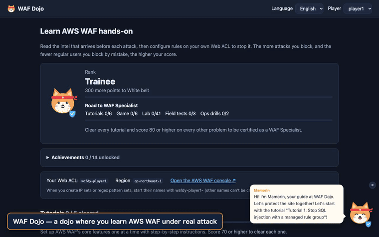

# WAF Dojo

**A hands-on training game for learning AWS WAF by defending against real attacks.**

**English** | [日本語](README.ja.md)

> **For administrators**: how to build the environment, hand it out to participants, run it, and clean up is covered in the [Admin guide (docs/ADMIN.md)](docs/ADMIN.md), and the handout for participants is [Getting started for players (docs/PLAYER_GUIDE.md)](docs/PLAYER_GUIDE.md). Both guides are currently in Japanese.

A hands-on environment for learning AWS WAF **while under attack**.

1. **Tutorials**: The screen shows what the incoming attack looks like (sample requests) and step-by-step setup instructions. You configure your Web ACL while following along.
2. **Game mode**: Unlocked once you clear the tutorials. Only an outline of the attack is given, and you design the rules to stop it yourself.
3. **Score**: You are scored on how many attacks you blocked and how many regular users you blocked by mistake, and the results go on a leaderboard.

Play solo or compete with others.

## Demo



The flow from reading a tutorial's attack and steps, to designing a rule in a vulnerability lab, launching the attack, reviewing the score and model answer, and finally opening a contest from the admin page (about 70 seconds). A higher-quality version is at [docs/demo-en.mp4](docs/demo-en.mp4).

> Recorded in development mode (`make dev`), which scores with the model answer instead of a real AWS WAF.

## Architecture

```
                    ┌───────────────────── per player ──────────────────┐
Browser ── Lambda Function URL (gameapi: UI + API)                      │
                │  async invoke                                          │
                ▼                                                        │
          Lambda (trafficgen) ── HTTPS ─▶ ALB ◀── Web ACL (edited by the player)
                │                          │                             │
                │                          ▼                             │
                │                  Lambda (targetapp: dummy online shop) │
                ▼                   └────────────────────────────────────┘
            DynamoDB (runs, best scores, locks)
```

- **targetapp**: A dummy app that returns 200 to every request, so any 4xx means WAF blocked it.
- **trafficgen**: Sends a mix of attack requests and regular-user requests according to the scenario, then scores the result. It only sends to **the player's own ALB**, as configured by Terraform.
  It uses [uTLS](https://github.com/refraction-networking/utls) to craft different TLS ClientHellos for browsers (Chrome / Firefox / Safari) and attack tools, so you can practice telling them apart by JA4 fingerprint.
- **gameapi**: The game UI and API, served from a Lambda Function URL.
- An ALB can only have one Web ACL, so each player gets their own ALB and Web ACL.
- To experience CloudFront's body inspection limit (16 KB by default, up to 64 KB), each player also gets a CloudFront distribution and a CloudFront-scoped Web ACL (`wafdojo-<name>-cf`, us-east-1). CloudFront fronts the dummy app's Lambda Function URL directly rather than the ALB, so the ALB's Web ACL rules do not apply there. Set `enable_cloudfront = false` to skip it.
- JA4 is only computed over HTTPS, so the ALB listens on HTTPS (443). To work without a domain, a self-signed certificate is generated and imported into ACM (its private key ends up in the Terraform state).
- Source IPs are represented by documentation addresses (RFC 5737) in `X-Forwarded-For` (the site is assumed to sit behind a CDN).

## Scenarios

### Tutorials (with steps; clear them all to unlock the game)

| ID | Topic | What you learn |
|---|---|---|
| tutorial-1-sqli | SQL injection | Managed rule groups |
| tutorial-2-xss | XSS in the review form | Custom rules (Rule builder), body inspection, text transformations |
| tutorial-3-ipset | IPs on a threat list | IP sets, CIDR, X-Forwarded-For |
| tutorial-4-useragent | Vulnerability scanners | String match on headers, OR statements, lowercase transformation |
| tutorial-5-ratelimit | Floods from a single IP | Rate-based rules, aggregation keys |
| tutorial-6-ja4 | A scraper posing as a browser | How JA4 fingerprints work and how to read them (a_b_c), exact JA4 match, WAF log analysis |

### Game mode (no steps; applied skills)

| ID | Topic | What you learn |
|---|---|---|
| game-1-fakebot | A scraper posing as Googlebot | Combining AND / NOT (UA says Googlebot AND the IP is not Google's) |
| game-2-admin | External access to the admin panel | URI path conditions + IP allow list, case sensitivity |
| game-3-traversal | Path traversal | Stacking text transformations (double decoding), avoiding false positives |
| game-4-cms | An XSS rule that blocks your editors | Building exceptions, rule priority, revisiting existing rules |
| game-5-bruteforce | Login brute force + corporate NAT | Scope-down statements, threshold design |
| game-6-ja4regex | A bot army that keeps tweaking its JA4 + a partner using the same library | JA4 regular expressions (catching the shared b part), preparing for unseen variants, exceptions with AND NOT |

Rules you created in the tutorials stay in place, so in game mode they sometimes cause false positives (stages 4 and 5). You need to revisit existing rules, not just stop new attacks.

### Vulnerability labs (43 challenges, no steps)

Each challenge reads: "A new vulnerability is out. It can be blocked under these conditions. Write the rule." The goal is to be able to write your own rules whenever a new vulnerability appears. After one attempt you can see the model-answer rule JSON (ready to paste into the console's Rule JSON editor) and an explanation. Many Level 2 and 3 challenges also include a "common pitfall" rule and why it fails.

| Level | Content | Challenges |
|---|---|---|
| Level 1: Follow the advisory | Turn guidance that spells out what to inspect, how to match, and the exact strings into a precise rule | Log4Shell, Spring4Shell, Shellshock, Confluence OGNL, F5 BIG-IP iControl REST, Next.js middleware bypass, Apache HTTP Server traversal, Text4Shell, Metabase GeoJSON (CVE-2021-41277), ProxyLogon (CVE-2021-26855), Confluence Velocity (CVE-2023-22527) |
| Level 2: Translate the advisory into WAF | Choose the inspected component, transformations, and match type yourself from prose conditions | PHP-CGI (CVE-2024-4577), Citrix ADC, FortiOS SSL-VPN, WebLogic console, Confluence setup, Spring Cloud Function, Struts 2 S2-045, vCenter vROps, XXE, GraphQL introspection, ProxyNotShell, CRLF injection, X-Original-URL, F5 BIG-IP TMUI (CVE-2020-5902), TeamCity (CVE-2024-27198) |
| Level 3: Derive it from the PoC | No mitigation guidance. Find the essence of the attack and prepare for both variants and false positives | Obfuscated Log4Shell, SSRF (metadata), SSTI, OS command injection, prototype pollution, open redirect, file upload, PAN-OS GlobalProtect (CVE-2024-3400), reading original advisories: Ivanti Connect Secure (CVE-2023-46805 / CVE-2024-21887), GitLab (CVE-2023-7028) |
| Level 4: Managed rules and WAF's limits | When a managed rule blocks legitimate traffic, fix it while keeping protection (per-rule Count override + label match). Prepare for WAF's own limits such as the body inspection limit | Core rule set SizeRestrictions_BODY (large uploads), NoUserAgent_HEADER (IoT devices), GenericRFI_QUERYARGUMENTS (an internal webhook tool), the 8 KB wall (body inspection limit and oversize handling; fixed at 8 KB on ALB), extending CloudFront's 16 KB wall to 64 KB (experienced live on the player's own CloudFront), the chunked bypass (a small-chunked Transfer-Encoding: chunked request slips past the size check on an ALB; verified on real AWS), and header folding (obs-fold, where a folded continuation lands in a header key on CloudFront and evades Match scope = Values; verified on real AWS) |

What the challenges build:

- Seeing the essence of an attack (targeting the part the attack cannot do without, not the eye-catching part of the PoC)
- Choosing what to inspect (URI path / query / a specific parameter / a specific header / all headers / body)
- Normalization (stacked URL decoding, lowercase, NORMALIZE_PATH, JS_DECODE)
- Match types (starts-with, regex, header presence via size, allow lists)
- Porting vendor mitigations (for example, AWS WAF regex does not support lookahead)
- Avoiding false positives (every challenge includes look-alike legitimate traffic such as `__typename`, `/mgmt-news`, or `${name}`)

Attack requests are harmless reproductions of the *shape* of real attacks, and every external destination uses a reserved domain such as `attacker.example`.

#### Quality assurance for the model answers

- `go test ./...` checks that the model answers for all 48 lab, exam, and ops challenges block every attack and no legitimate request (the evaluator in `internal/wafrule` reproduces AWS WAF's matching locally).
- It also checks that each common-pitfall rule really does let attacks through or cause false positives.
- The JSON of the model answers and pitfall rules has been syntax-checked with the AWS WAF CheckCapacity API.
- On real AWS (ALB + WAF), every challenge has been confirmed to let attacks through with no rules and to score 100 with the model answer. ALB rejects with 400, before WAF, any path that climbs above the site root after one decode, so tests also make sure no such path is used. To re-check (no resources are created):

```sh
mkdir -p /tmp/rules && WAFDY_EXPORT_RULES=/tmp/rules go test -run TestExportLabRules ./internal/scenario/
for f in /tmp/rules/*.json; do aws wafv2 check-capacity --scope REGIONAL --cli-binary-format raw-in-base64-out --rules file://$f; done
```

The Core rule set used in Level 4 alone consumes 700 WCU. The lab model answers add up to about 1,000 WCU, which together with tutorial and game rules approaches the Web ACL limit (1,500 WCU by default). Deleting the rules of challenges you have mastered keeps your records.

The Level 4 managed rules are reproduced in the evaluator from AWS's published rule descriptions (the actual contents are not public, so it is not an exact reproduction). Rule and label names have been confirmed against the real ones with AWS's DescribeManagedRuleGroup API.

### Ops drills (2 challenges, with recon)

As in real operations, you first run a "recon" (unscored) with Count rules, study the WAF logs, and then take the real run.

| Challenge | Content |
|---|---|
| Find the false-positive culprit | Find, from the logs, the legitimate traffic (a partner's email template sync) that trips your XSS rule, and carve out an exception. The legitimate traffic is not shown on screen |
| Identify the bot from the logs | Find the credential-stuffing bot's JA4 by aggregating /login requests in Logs Insights. The JA4 is not shown on screen |

### Exams (3 challenges; attack details and model answers are hidden)

Tests that send variants of lab attacks you have not seen yet. Copying the lab model answers will not pass.

| Challenge | Content |
|---|---|
| Log4Shell mutants | Log4Shell anywhere in headers, query, or body, using nesting, double encoding, and JSON escapes |
| Path traversal grand tour | Traversal in path, query, cookies, and JSON, in Linux and Windows styles with assorted encodings |
| Doors that must stay shut | Access to .git, .env, actuator and the like, via uppercase, duplicated slashes, ../ detours, `;`, and encoding |

### Game elements

- **Ranks**: Based on the sum of best scores outside the tutorials, you rise from Trainee → White belt → Yellow → Green → Blue → Brown → Black belt, and become "Master" when certified as a WAF specialist.
- **Achievements**: 14 kinds, such as "First perfect", "Ten on my own (no hints)", "Log4Shell hunter", and "Fingerprint expert (JA4)".
- **Mamorin, your guide**: From the bottom-right corner, Mamorin suggests what to try next, gives per-challenge tips, and reacts to your results (perfect, leaks, false positives). Click for a tip; hide with ×.
- Confetti celebrates perfect scores, rank-ups, and new achievements.

### WAF specialist certification

Clear every tutorial and score 80 or higher on all 54 other challenges (6 game, 43 lab, 3 exam, 2 ops) to be shown as a 🏅 WAF specialist in the lobby and on the leaderboard.

Add scenarios by calling `register(...)` (or `lab(level, ...)` for labs) in the files under `internal/scenario/`. If you also write a model answer for a lab, the tests verify its correctness automatically.

### Contest mode

An administrator can open a contest from the admin page (`make admin` prints its URL): pick any game, lab, ops, or exam problems and an optional time limit. Every player's screen switches to the contest, where they can solve the chosen problems right away without the tutorials. Hints are allowed (×0.8), model answers unlock when the contest ends, and the contest leaderboard ranks players by the sum of their best scores (ties go to whoever got there first). Contest scores are recorded separately from practice records. See the [admin guide](docs/ADMIN.md) for details.

## Languages

The UI supports Japanese and English, switchable from "Language" in the header. The initial choice follows the browser's language settings, and your choice is saved in the browser.

To add a language, add it in three places:

1. `Lang` and `Langs` in `internal/scenario/i18n.go`
2. Scenario text (`T(...)` in `internal/scenario/*.go`) and API messages (`messages` in `cmd/gameapi/main.go`). `Text` is a `map[Lang]string`, so you can add translations like `Text{Japanese: ..., English: ..., "ko": ...}`
3. UI strings (`I18N` and `LANG_NAMES` in `cmd/gameapi/web/app.js`)

Untranslated text falls back to English, then Japanese. `go test ./...` checks scenarios and API messages for missing translations.

## Scoring

```
score = 100 × attack block rate × (1 − false-positive rate)      × 0.8 if you viewed hints
```

- Each tutorial is cleared at 70 or higher. Clearing all 6 unlocks game mode and the vulnerability labs. Tutorials do not count toward the leaderboard total.
- Every other challenge (game, lab, exam, ops) is worth up to 100 points and counts as "mastered" at 80 or higher. Your leaderboard total and rank come from the sum of these personal bests.
- Ops-drill recon runs are not scored or recorded.
- A 400 returned by the ALB for a malformed request is not counted as a WAF block; it is treated as a network error and excluded from scoring.
- Scenarios with rate-based rules (tutorial 5, stage 5) do not score the first 60 seconds of attacks, to give the rule time to kick in.
- Game mode has a preparation time (7–8 minutes); when it runs out, the attack starts automatically.

## Requirements

- Go 1.26 or later
- Terraform 1.6 or later
- AWS credentials with near-administrator permissions

## Deploy

```sh
aws sts get-caller-identity   # always confirm the target AWS account first
cp terraform/terraform.tfvars.example terraform/terraform.tfvars   # edit player_count etc. (you will be prompted if omitted)
make deploy      # tests → build the Lambdas → terraform apply
```

Even when playing solo, open the game from your own `game_url`, shown by `terraform -chdir=terraform output -json player_access`.

### Playing with multiple people (each player can only touch their own settings)

`terraform apply` asks for the number of players (`player_count`); you can also set it in `terraform.tfvars`. Players `player1`, `player2`, ... are created, each with their own ALB and Web ACL.

Show the information to hand out to each player with the command below (it contains passwords and tokens, so give each player only their own).

```sh
terraform -chdir=terraform output -json player_access
```

| Field | Content |
|---|---|
| `game_url` | The player's own game URL (with a secret token). Only someone who opened this URL can start attacks or view model answers as that player. The token is stored in the browser and removed from the address bar. Opening without a token gives spectator mode (leaderboard and challenges are visible) |
| `console_signin` / `console_user` / `console_pass` | AWS console sign-in for the player's own IAM user |
| `ipset_prefix` | Prefix for IP set and regex pattern set names (e.g. `wafdojo-player1-`) |

What a player's IAM user can and cannot do (verified with the IAM policy simulator):

- Can: change the rules of their own Web ACL; create, change, and delete IP sets and regex pattern sets whose names start with `wafdojo-<self>-`; search their own WAF logs in Logs Insights; list and inspect managed rule groups
- Cannot: view or change other players' Web ACLs, IP sets, or logs; delete Web ACLs; change ALB associations; change logging settings; tamper with scores; invoke the attack Lambda directly

If your organization does not allow IAM users, set `create_player_users = false` (players then only get the game token).

## Try the UI locally

```sh
make dev   # http://127.0.0.1:8080
```

Development mode runs the UI and API without AWS. Data is kept in memory and no attacks are actually sent; labs return the result of applying the model-answer rule as the score. Append a challenge ID such as `#/lab-3-ssrf-metadata` to the URL to open it directly, and use `?lang=en` to pick the language.

## Cleanup

```sh
make destroy
```

Web ACL rules added in the console are deleted together with the Web ACL. Delete any IP sets or regex pattern sets you created in the console by hand.

## Estimated cost

The main costs incurred even when idle are the two below. Run `make destroy` when you are done.

- ALB: about $0.0243 per hour per ALB + LCU
- AWS WAF: $5 per Web ACL per month + $1 per rule per month (prorated hourly) + $0.60 per million requests

Lambda, DynamoDB, and CloudWatch Logs cost little at learning-scale usage. Paid managed rules such as Bot Control incur extra charges.

## Notes

- The ALB is exposed to the internet, so unrelated scans may arrive. Scoring only uses responses to requests sent by the generator, so they do not affect scores.
- Web ACL rules are not managed by Terraform (`ignore_changes = [rule]`). Re-running `terraform apply` does not erase players' settings.

## License

This software is licensed under the [PolyForm Shield License 1.0.0](LICENSE.md). The source code is public, but its use is subject to conditions, so it is not an open source license.

**Summary (the official terms are in [LICENSE.md](LICENSE.md))**

- You may freely use and modify it for personal learning, internal training at companies and organizations, school classes, and so on.
- You may not provide a product or service that competes with this software. For example, you may not sell or offer this software (including modified versions) as a WAF training service or course material. Offering it for free also counts as competing.
- When redistributing, include the license text (or its URL) and the line starting with `Required Notice:` (`Required Notice: Copyright Akira Nishikawa`).
- No warranty.
- **For use in paid training, please contact info@i-wind.jp.**

### Responsible use

This software sends requests that reproduce the shape of real attacks. It only sends them to the ALBs of the environment it creates, but if you modify it, use it **only against environments you own**.

Required Notice: Copyright Akira Nishikawa
