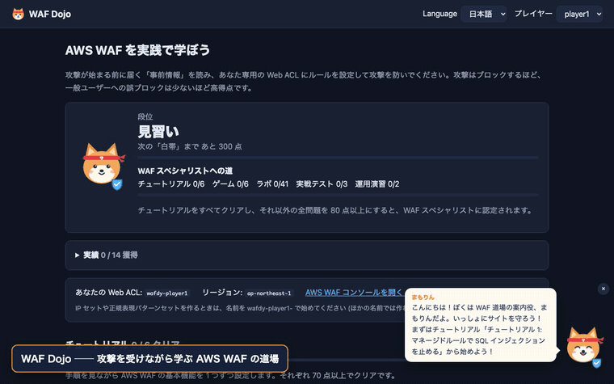

# WAF Dojo (wafdy)

> **管理者の方へ**: 環境の作り方・参加者への配り方・運用・片付けは [管理者ガイド (docs/ADMIN.md)](docs/ADMIN.md) に、参加者に配る説明は [プレイヤー向けのはじめ方 (docs/PLAYER_GUIDE.md)](docs/PLAYER_GUIDE.md) にまとめています。

AWS WAF を「攻撃を受けながら」学ぶための学習環境です。

1. **チュートリアル**: これから来る攻撃の中身（リクエスト例）と設定手順が画面に出るので、それを見ながら Web ACL を設定します。
2. **ゲームモード**: チュートリアルをクリアすると解放されます。攻撃の概要だけが説明されるので、防ぐためのルールを自分で考えて設定します。
3. **スコア**: 攻撃をどれだけブロックできたか、一般ユーザーをどれだけ誤ってブロックしたかで採点し、ランキングに表示します。

一人でも、複数人で競っても遊べます。

## デモ



チュートリアルで攻撃と手順を確認し、脆弱性対応ラボでルールを考えて攻撃を開始、採点と模範解答を見るまでの流れです（約 1 分）。高画質版は [docs/demo.mp4](docs/demo.mp4) をご覧ください。

> 画面は開発モード (`make dev`) で撮影しています。開発モードでは本物の AWS WAF の代わりに模範解答で採点します。

## 構成

```
                    ┌─────────────── プレイヤーごと ───────────────┐
ブラウザ ── Lambda Function URL (gameapi: 画面 + API)               │
                │  非同期呼び出し                                   │
                ▼                                                   │
          Lambda (trafficgen) ── HTTPS ─▶ ALB ◀── Web ACL (プレイヤーが編集)
                │                          │                        │
                │                          ▼                        │
                │                  Lambda (targetapp: ダミーの EC サイト)
                ▼                   └───────────────────────────────┘
            DynamoDB（実行結果・ベストスコア・ロック）
```

- **targetapp**: どのリクエストにも 200 を返すダミーアプリ。4xx が返ってきたら WAF がブロックしたと判定できます。
- **trafficgen**: シナリオどおりに攻撃リクエストと一般ユーザーのリクエストを混ぜて送り、結果を採点します。送信先は Terraform が設定した**自分の ALB だけ**です。
  [uTLS](https://github.com/refraction-networking/utls) を使って、ブラウザ (Chrome / Firefox / Safari) と攻撃ツールで TLS の ClientHello を作り分けているので、JA4 フィンガープリントで見分ける練習ができます。
- **gameapi**: ゲーム画面と API。Lambda Function URL で公開します。
- ALB には Web ACL を 1 つしか付けられないので、プレイヤーごとに ALB と Web ACL を 1 つずつ作ります。
- CloudFront の Body の検査上限 (既定 16 KB・最大 64 KB) を体験するため、プレイヤーごとに CloudFront と CloudFront 用の Web ACL (`wafdy-<名前>-cf`、us-east-1) も作ります。CloudFront の後ろには ALB ではなくダミーアプリ (Lambda Function URL) を直接つなぐので、ALB 側の Web ACL のルールは効きません。`enable_cloudfront = false` で作らないようにもできます。
- JA4 は HTTPS でしか計算されないため、ALB は HTTPS (443) で受けます。ドメインがなくても動くように、自己署名証明書を作って ACM にインポートしています（秘密鍵は Terraform の state に入ります）。
- 送信元 IP は、ドキュメント用の IP アドレス (RFC 5737) を `X-Forwarded-For` に入れて表現しています（「CDN の後ろにあるサイト」という設定）。

## シナリオ

### チュートリアル（手順つき・すべてクリアでゲーム解放）

| ID | 内容 | 学べること |
|---|---|---|
| tutorial-1-sqli | SQL インジェクション | マネージドルールグループ |
| tutorial-2-xss | 口コミ欄への XSS | カスタムルール (Rule builder)、Body の検査、テキスト変換 |
| tutorial-3-ipset | 攻撃者リストの IP | IP セット、CIDR、X-Forwarded-For |
| tutorial-4-useragent | 脆弱性スキャナー | ヘッダーの文字列マッチ、OR ステートメント、Lowercase 変換 |
| tutorial-5-ratelimit | 単一 IP からの大量アクセス | レートベースルール、集計キー |
| tutorial-6-ja4 | ブラウザを名乗るスクレイピングツール | JA4 フィンガープリントの仕組みと読み方 (a_b_c)、JA4 の完全一致、WAF ログの分析 |

### ゲームモード（手順なし・応用）

| ID | 内容 | 学べること |
|---|---|---|
| game-1-fakebot | Googlebot を名乗るスクレイパー | AND / NOT の組み合わせ（UA が Googlebot かつ Google の IP ではない） |
| game-2-admin | 管理画面への外部アクセス | URI パスの条件 + IP 許可リスト、大文字小文字 |
| game-3-traversal | パストラバーサル | テキスト変換の重ねがけ（二重デコード）、誤検知への配慮 |
| game-4-cms | XSS ルールが編集者を止めてしまう | 例外の作り方、ルールの優先度、既存ルールの見直し |
| game-5-bruteforce | ログインの総当たり + 社内 NAT | スコープダウンステートメント、しきい値の設計 |
| game-6-ja4regex | JA4 を少しずつ変えるボット軍団 + 同じライブラリを使う取引先 | JA4 の正規表現（共通する b 部分をとらえる）、未観測の亜種への備え、AND NOT による例外 |

チュートリアルで作ったルールはそのまま残るので、ゲームモードではそれが誤ブロックの原因になる場面もあります（ステージ 4・5）。新しい攻撃を止めるだけでなく、既存ルールの見直しも求められます。

### 脆弱性対応ラボ（全 41 問・手順なし）

「〜という脆弱性が出ました。こういう条件で防げるようです。ルールを作ってください」という形の問題です。新しい脆弱性が出たときに、自分でルールを作れるようになることを目標にしています。一度挑戦すると、模範解答のルール JSON（コンソールの Rule JSON editor にそのまま貼り付けられる形）と解説が見られます。Level 2・3 の多くの問題には「ありがちな失敗ルール」とその理由も付いています。

| レベル | 内容 | 問題 |
|---|---|---|
| Level 1: 勧告どおりに書く | 検査対象・照合方法・文字列まで書かれた防ぎ方の情報を、正確にルールにする | Log4Shell, Spring4Shell, Shellshock, Confluence OGNL, F5 BIG-IP iControl REST, Next.js middleware bypass, Apache HTTP Server traversal, Text4Shell, Metabase GeoJSON (CVE-2021-41277), ProxyLogon (CVE-2021-26855), Confluence Velocity (CVE-2023-22527) |
| Level 2: 勧告を WAF に翻訳する | 文章の条件から、検査対象・テキスト変換・照合方法を自分で選ぶ | PHP-CGI (CVE-2024-4577), Citrix ADC, FortiOS SSL-VPN, WebLogic console, Confluence setup, Spring Cloud Function, Struts 2 S2-045, vCenter vROps, XXE, GraphQL introspection, ProxyNotShell, CRLF injection, X-Original-URL, F5 BIG-IP TMUI (CVE-2020-5902), TeamCity (CVE-2024-27198) |
| Level 3: PoC から自分で導く | 防ぎ方の情報なし。攻撃の本質を見抜き、亜種と誤検知の両方に備える | 難読化 Log4Shell, SSRF (メタデータ), SSTI, OS コマンドインジェクション, Prototype pollution, オープンリダイレクト, ファイルアップロード, PAN-OS GlobalProtect (CVE-2024-3400), 勧告の原文を読む: Ivanti Connect Secure (CVE-2023-46805 / CVE-2024-21887), GitLab (CVE-2023-7028) |
| Level 4: マネージドルールと WAF の限界 | マネージドルールが正規の通信を止めたとき、保護を保ったまま直す (ルール単位の Count 上書き + ラベル一致)。Body の検査上限のような WAF そのものの限界に備える | Core rule set の SizeRestrictions_BODY (大きなアップロード), NoUserAgent_HEADER (IoT 機器), GenericRFI_QUERYARGUMENTS (社内の Webhook ツール), 8 KB の壁 (Body の検査上限と Oversize handling。ALB は 8 KB 固定)、CloudFront で 16 KB の壁を 64 KB まで広げる (プレイヤー専用の CloudFront で実際に体験) |

問題を通して身につくこと:

- 攻撃の本質を見抜く（PoC の目立つ部分ではなく、攻撃に欠かせない部分をとらえる）
- 検査対象の選び方（URI パス / クエリ / 特定パラメータ / 特定ヘッダー / すべてのヘッダー / Body）
- 正規化（URL decode の重ねがけ、Lowercase、NORMALIZE_PATH、JS_DECODE）
- 照合方法（前方一致・正規表現・サイズでのヘッダーの有無・許可リスト）
- ベンダーの緩和策の移植（AWS WAF の正規表現は先読みに対応していない、など）
- 誤検知の回避（`__typename`、`/mgmt-news`、`${name}` のような「似ているが正規」の通信が各問題に入っています）

攻撃リクエストは実際の攻撃の「形」だけを再現した無害なもので、外部の宛先にはすべて `attacker.example` などの予約ドメインを使っています。

#### 模範解答の品質保証

- `go test ./...` で、ラボ・実戦テスト・運用演習の全 46 問の模範解答が「攻撃をすべて止め、正常な通信を 1 件も止めない」ことを確かめています（`internal/wafrule` の評価器で、AWS WAF の判定をローカルで再現）。
- ありがちな失敗ルールが、本当にすり抜けか誤検知を起こすことも確かめています。
- 模範解答と失敗ルールの JSON は、AWS WAF の CheckCapacity API で文法を確認済みです。
- 実際の AWS 環境 (ALB + WAF) でも、全問について「ルールなしでは攻撃が通る」「模範解答で 100 点」になることを確認しています。ALB は、1 回デコードするとサイトのルートより上に遡るパスを WAF より前に 400 で拒否するため、そのようなパスを使わないこともテストで確かめています。確認し直すときは次のようにします（リソースは作られません）。

```sh
mkdir -p /tmp/rules && WAFDY_EXPORT_RULES=/tmp/rules go test -run TestExportLabRules ./internal/scenario/
for f in /tmp/rules/*.json; do aws wafv2 check-capacity --scope REGIONAL --cli-binary-format raw-in-base64-out --rules file://$f; done
```

Level 4 で使う Core rule set だけで 700 WCU を使います。ラボの模範解答の WCU を合計すると約 1,000 になり、チュートリアルやゲームのルールと合わせると Web ACL の上限 (既定 1,500 WCU) に近づきます。こなした問題のルールは削除しても記録は残ります。

Level 4 のマネージドルールは、AWS が公開しているルールの説明に沿って評価器で再現しています（中身は非公開なので完全な再現ではありません）。ルール名とラベル名は、AWS の DescribeManagedRuleGroup API で本物と一致することを確認しています。

### 運用演習（2 問・偵察あり）

本番の運用と同じように、まず Count のルールで「偵察」(採点なし) してから、WAF ログを調べて本番に臨む問題です。

| 問題 | 内容 |
|---|---|
| 誤検知の犯人探し | XSS 対策のルールに一致してしまう正規の通信 (取引先のメールテンプレート同期) を、ログから見つけて例外にする。正規の通信の例は画面に出しません |
| ログからボットを特定せよ | リスト型攻撃のボットの JA4 を、Logs Insights で /login へのリクエストを集計して見つける。JA4 は画面に出しません |

### 実戦テスト（3 問・攻撃の詳細と模範解答は非公開）

ラボで学んだ攻撃の「まだ見せていない亜種」が来るテストです。ラボの模範解答を写しただけでは通りません。

| 問題 | 内容 |
|---|---|
| Log4Shell の変異体 | ヘッダー・クエリ・Body のどこにでも、入れ子・二重エンコード・JSON のエスケープを使った Log4Shell が来る |
| パストラバーサル総まとめ | パス・クエリ・Cookie・JSON に、Linux / Windows 形式と様々なエンコードの遡りが来る |
| 開けてはいけない扉 | .git・.env・actuator などへのアクセスが、大文字・スラッシュの重複・../ の遠回り・; ・エンコードで来る |

### ゲームの要素

- **段位**: チュートリアル以外のベストスコアの合計で、見習い → 白帯 → 黄帯 → 緑帯 → 青帯 → 茶帯 → 黒帯と上がり、WAF スペシャリストになると「師範」になります。
- **実績**: 「はじめての満点」「自力の 10 問 (ヒントなし)」「Log4Shell ハンター」「指紋鑑定士 (JA4)」など 14 種類。
- **案内役のまもりん**: 画面の右下で、次に挑戦する問題のおすすめ、問題ごとのコツ、結果への反応 (満点・すり抜け・誤ブロック) を話します。クリックするとワンポイントを教えてくれます。× で隠せます。
- 満点を取ったときや、段位が上がったとき、実績を取ったときは紙吹雪でお祝いします。

### WAF スペシャリスト認定

チュートリアルをすべてクリアし、それ以外の全 52 問 (ゲーム 6・ラボ 41・実戦テスト 3・運用演習 2) をすべて 80 点以上にすると、ロビーとランキングに 🏅 WAF スペシャリストとして表示されます。

シナリオは `internal/scenario/` の各ファイルに `register(...)`（ラボは `lab(level, ...)`）を足せば増やせます。ラボの問題を足すときは模範解答も書くと、テストで正しさが自動的に確かめられます。

## 多言語対応

画面は日本語と英語に対応しています。ヘッダーの「言語 / Language」で切り替えられます。最初はブラウザの言語設定に合わせて選ばれ、選んだ言語はブラウザに保存されます。

言語を増やすときは、次の 3 か所に追加します。

1. `internal/scenario/i18n.go` の `Lang` と `Langs`
2. シナリオの文章 (`internal/scenario/*.go` の `T(...)`) と API のメッセージ (`cmd/gameapi/main.go` の `messages`)。`Text` は `map[Lang]string` なので、`Text{Japanese: ..., English: ..., "ko": ...}` のように訳を足せます
3. 画面の文言 (`cmd/gameapi/web/app.js` の `I18N` と `LANG_NAMES`)

訳がない文章は英語、次に日本語で表示されます。`go test ./...` を実行すると、シナリオと API メッセージに訳の抜けがないかを確認できます。

## スコア

```
スコア = 100 × 攻撃のブロック率 × (1 − 誤ブロック率)      ヒントを見た場合は × 0.8
```

- チュートリアルは各 70 点以上でクリア。6 本すべてクリアするとゲームモードと脆弱性対応ラボが解放されます。ランキングの合計には含みません。
- チュートリアル以外の問題 (ゲーム・ラボ・実戦テスト・運用演習) は各 100 点満点。80 点以上で「こなした」ことになります。ランキングの合計と段位は、これらの自己ベストの合計で決まります。
- 運用演習の「偵察」は採点されず、記録にも残りません。
- ALB が不正なリクエストとして返した 400 は、WAF のブロックとは数えず、通信エラーとして採点から除きます。
- レートベースルールを使うシナリオ（チュートリアル 5・ステージ 5）は、ルールの立ち上がりを待つため最初の 60 秒の攻撃を採点しません。
- ゲームモードには準備時間（7〜8 分）があり、時間切れになると自動で攻撃が始まります。

## 必要なもの

- Go 1.26 以上
- Terraform 1.6 以上
- 管理者に近い権限の AWS 認証情報

## デプロイ

```sh
aws sts get-caller-identity   # デプロイ先の AWS アカウントを必ず確認する
cp terraform/terraform.tfvars.example terraform/terraform.tfvars   # player_count などを編集 (なければ実行時に聞かれる)
make deploy      # テスト → Lambda のビルド → terraform apply
```

一人で遊ぶ場合も、`terraform -chdir=terraform output -json player_access` で表示される自分の `game_url` から開いてください。

### 複数人で遊ぶとき（自分の設定しか触れない仕組み）

`terraform apply` のときにプレイ人数 (`player_count`) を聞かれます。`terraform.tfvars` に書いておくこともできます。人数分の `player1`, `player2`, ... が作られ、1 人につき ALB と Web ACL が 1 つずつ用意されます。

各プレイヤーに配る情報は次のコマンドで表示できます（パスワードとトークンを含むので、本人にだけ渡してください）。

```sh
terraform -chdir=terraform output -json player_access
```

| 項目 | 内容 |
|---|---|
| `game_url` | 自分専用のゲーム画面の URL (秘密のトークン付き)。この URL で開いた人だけが、そのプレイヤーとして攻撃開始や模範解答の閲覧ができる。トークンはブラウザに保存され、アドレスバーからは消える。トークンなしで開くと観戦モード (ランキングと問題は見られる) |
| `console_signin` / `console_user` / `console_pass` | AWS コンソールのログイン情報 (プレイヤー専用の IAM ユーザー) |
| `ipset_prefix` | IP セット・正規表現パターンセットの名前の先頭に付ける文字列 (例: `wafdy-player1-`) |

プレイヤー専用の IAM ユーザーができること / できないこと（IAM ポリシーシミュレーターで確認済み）:

- できる: 自分の Web ACL のルールの変更、名前が `wafdy-<自分>-` で始まる IP セット・正規表現パターンセットの作成・変更・削除、自分の WAF ログの Logs Insights での検索、マネージドルールの一覧と中身の確認
- できない: 他のプレイヤーの Web ACL・IP セット・ログを見ること・変えること、Web ACL の削除、ALB との関連付けの変更、ログ設定の変更、スコアの書き換え、攻撃用 Lambda の直接実行

組織のルールで IAM ユーザーを作れない場合は `create_player_users = false` にしてください（ゲーム画面のトークンだけになります）。

## 画面だけをローカルで確かめる

```sh
make dev   # http://127.0.0.1:8080
```

AWS なしで画面と API を動かせる開発モードです。データはメモリ上に保存し、攻撃は実際には送りません。ラボは模範解答のルールを当てた結果を採点結果として返します。URL に `#/lab-3-ssrf-metadata` のように問題 ID を付けるとその画面を直接開け、`?lang=en` で言語を指定できます。

## 片付け

```sh
make destroy
```

Web ACL のルールはコンソールで足したものですが、Web ACL と一緒に削除されます。IP セットや正規表現パターンセットをコンソールで作った場合は、それらは手で削除してください。

## 費用の目安

使っていないときもかかるのは主に次の 2 つです。遊び終わったら `make destroy` してください。

- ALB: 1 台あたり 1 時間 約 $0.0243 + LCU
- AWS WAF: Web ACL 1 つあたり月 $5 + ルール 1 つあたり月 $1（時間割）+ リクエスト 100 万件あたり $0.60

Lambda・DynamoDB・CloudWatch Logs は学習で使う程度なら少額です。Bot Control などの有料マネージドルールを入れると追加料金がかかります。

## 注意

- ALB はインターネットに公開されるので、ゲームと関係ないスキャンも届くことがあります。採点は生成器が送ったリクエストの応答だけで行うので、スコアには影響しません。
- Web ACL のルールは Terraform の管理外です（`ignore_changes = [rule]`）。`terraform apply` をやり直してもプレイヤーの設定は消えません。

## ライセンス

このソフトウェアは [PolyForm Shield License 1.0.0](LICENSE.md) で提供しています。ソースコードは公開していますが、利用に条件があるため、オープンソースライセンスではありません。

**要約 (正式な条件は英語の原文 [LICENSE.md](LICENSE.md) です)**

- 個人の学習、企業・団体の社内研修、学校の授業などで、自由に利用・改変できます。
- このソフトウェアと競合する製品やサービスを提供することはできません。たとえば、このソフトウェア (改変したものを含む) を WAF の研修サービスや学習教材として販売・提供することはできません。無料で提供する場合も競合にあたります。
- 再配布するときは、ライセンスの本文 (または URL) と、`Required Notice:` で始まる行 (`Required Notice: Copyright Akira Nishikawa`) を一緒に渡してください。
- 無保証です。
- **有料の研修で利用したい場合は、info@i-wind.jp までご相談ください。**

### 利用上の注意

このソフトウェアは、実際の攻撃の形を再現したリクエストを送ります。送り先はこのソフトウェアが作る環境の ALB だけですが、改変して使う場合も、**自分が管理する環境に対してだけ** 使ってください。

## License

This software is licensed under the [PolyForm Shield License 1.0.0](LICENSE.md). You may use and modify it for any purpose — including personal learning, internal corporate training, and classroom use — except providing a product that competes with it (for example, selling or offering it, or a modified version, as a WAF training service or course material). See [LICENSE.md](LICENSE.md) for the full terms. For paid training, please contact info@i-wind.jp.

Required Notice: Copyright Akira Nishikawa
